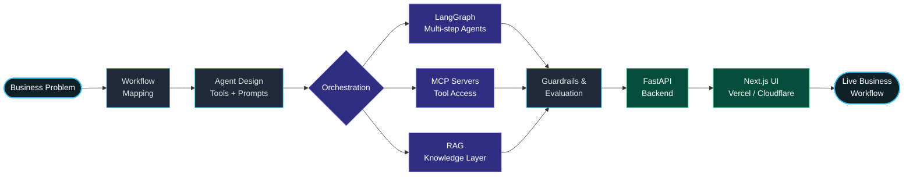
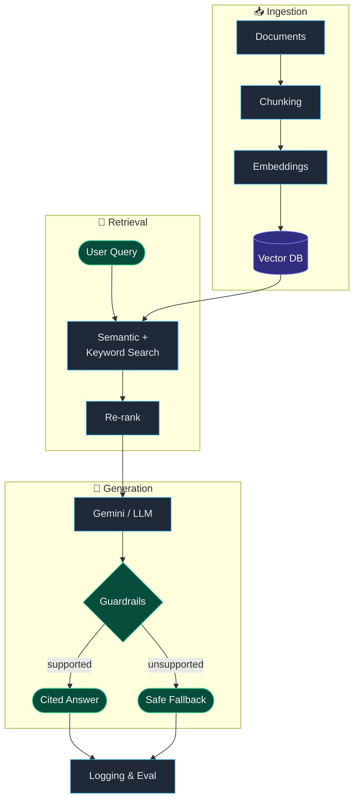
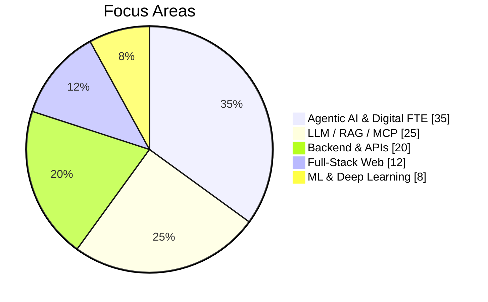

<!-- ========================= HEADER ========================= -->
<div align="center">


<a href="https://github.com/AqsaMalik6">
  
</a>

<br/>

[](https://www.linkedin.com/in/aqsamalik-agenticai)
[](https://aqs-aportfolio-g26q.vercel.app/)
[](mailto:aqsam3602@gmail.com)
[](https://github.com/AqsaMalik6)


</div>

<br/>

<!-- ========================= ABOUT ========================= -->
## 👩‍💻 About Me

```python
class AqsaMalik:
    def __init__(self):
        self.role      = "Agentic AI Developer"
        self.location  = "Faisalabad, Pakistan"
        self.focus     = ["AI Agents", "Digital FTE", "MCP Servers",
                          "RAG Systems", "Workflow Automation"]
        self.stack     = ["Python", "FastAPI", "Next.js", "PostgreSQL"]
        self.mission   = "Turn AI into real, working business tools - not demos."

    def what_i_build(self):
        return ("Autonomous agents -> Business integrations -> "
                "Guardrails -> Deployment -> Monitoring")
```

> **I design and build production-ready AI agents, autonomous SaaS systems, and full-stack AI platforms** that plug directly into business workflows — CRMs, messaging platforms, calendars, and internal tools — not just isolated chatbots.

- 🤖 Building **autonomous AI agents** and **Digital FTE** systems for sales & support automation
- 🔌 Developing **MCP (Model Context Protocol)** servers to connect LLMs with real tools & APIs
- 📚 Designing **RAG pipelines** with vector databases and guardrails
- ⚙️ Shipping lean, cost-efficient backends with **FastAPI + PostgreSQL**
- 🌐 Full-stack delivery with **Next.js, React.js & TypeScript**
- 📩 **Open to** Agentic AI / AI Engineering roles, freelance automation projects & startup collaborations

---

<!-- ========================= TECH STACK ========================= -->
## 🛠️ Tech Stack

<div align="center">


</div>

### 🤖 Agentic AI & LLMs


### 💻 Programming


### ⚙️ Backend & Web


### 🗄️ Databases


### 📊 Machine Learning


| Family | Algorithms |
| :-- | :-- |
| 📈 **Regression** | Linear Regression · Logistic Regression |
| 🌳 **Tree-based** | Decision Tree · Random Forest |
| 🎯 **Classical** | SVM · KNN · Naive Bayes |
| 🧩 **Clustering** | K-Means |

### 🧠 Deep Learning & Computer Vision


### 📚 Libraries


### 🚀 Tools & Deployment


---

<!-- ========================= HOW I BUILD ========================= -->
## 🧭 How I Build AI Agents



| Stage | What I Do |
| :-- | :-- |
| 🔍 **Understand** | Map the business workflow and find what should be automated |
| 🧱 **Design** | Define agent roles, tools, memory and prompts |
| 🧠 **Build** | LangChain / LangGraph agents, MCP servers, RAG pipelines |
| 🛡️ **Protect** | Guardrails, validation and evaluation |
| 🚀 **Ship** | FastAPI services, Next.js frontends, deploy on Vercel / Cloudflare |
| 🔌 **Integrate** | WhatsApp, Twilio, CRMs, calendars, internal tools |

---

<!-- ========================= RAG DIAGRAM ========================= -->
## 📚 A RAG System I Build



---

<!-- ========================= FOCUS CHART ========================= -->
## 📊 Where I Spend My Time



> ✏️ *Percentages are a starting point — change them to match your real time split.*

---

<!-- ========================= PROJECTS ========================= -->
## 🚀 Featured Projects

<!-- Replace each REPO_NAME and description with your real repositories -->
<table>
  <tr>
    <td width="50%">
      <a href="https://github.com/AqsaMalik6/REPO_NAME_1">
        
      </a>
    </td>
    <td width="50%">
      <a href="https://github.com/AqsaMalik6/REPO_NAME_2">
        
      </a>
    </td>
  </tr>
  <tr>
    <td width="50%">
      <a href="https://github.com/AqsaMalik6/REPO_NAME_3">
        
      </a>
    </td>
    <td width="50%">
      <a href="https://github.com/AqsaMalik6/REPO_NAME_4">
        
      </a>
    </td>
  </tr>
</table>

| Project | What it does | Stack |
| :-- | :-- | :-- |
| 🤖 **Project 1** | One line: the business problem it solves | `Python` `FastAPI` `LangGraph` |
| 🔌 **Project 2** | One line: what it automates | `MCP` `Next.js` `PostgreSQL` |
| 📚 **Project 3** | One line: what knowledge it answers from | `RAG` `Vector DB` `Gemini` |
| 📱 **Project 4** | One line: which channel it works on | `Twilio` `WhatsApp` `FastAPI` |

---

<!-- ========================= GITHUB ANALYTICS ========================= -->
## 📈 GitHub Analytics

<div align="center">


</div>

---

<!-- ========================= CONNECT ========================= -->
## 🤝 Let's Build Something

**Open to Agentic AI / AI Engineering roles, freelance automation projects, and collaborations with startups building AI-native products.**

<div align="center">

[](mailto:aqsam3602@gmail.com)
[](https://www.linkedin.com/in/aqsamalik-agenticai)
[](https://aqs-aportfolio-g26q.vercel.app/)

<br/>


<br/>

> *"Don't build AI demos — build AI that works inside the business."*

⭐ From [**@AqsaMalik6**](https://github.com/AqsaMalik6) — thanks for stopping by!


</div>
